# Design Research: AI Hub Landing Page — แพทเทิร์นจาก PRD

อ้างอิง: `AIHub_Landing_Page_PRD_v1.md` (FR-AIHUB-001 ถึง 014) · วันที่: 2026-10-30 · Lazyweb search: `1f104a5b-96ad-4e63-ad0f-76e9a78b4e09`

## TL;DR

PRD ต้องการให้ผู้เข้าชมเข้าใจ AI Hub ภายในไม่กี่วินาที แล้วดูโมเดล ดูราคา และสมัครได้เลยโดยไม่ผ่านทีมขาย แพทเทิร์นที่เจอซ้ำในกลุ่ม AI platform คือ **"ตารางหรือการ์ดโมเดลที่ค้นหาและกรองได้ พร้อมราคาต่อ token"** วางเป็นหัวใจของหน้า แล้วใช้ hero, pricing และ docs เป็นตัวพาไปสมัคร ข้อควรระวังจากการค้นคือ PRD มีจุดที่ยังขัดกันเอง (OQ-013, OQ-025) ต้องตัดสินใจก่อนออกแบบ Models, Pricing และ CTA

> หมายเหตุขอบเขต: Lazyweb คลัง desktop มี reference คุณภาพดีสำหรับ model catalog, pricing และ agent marketplace แต่ **ไม่มี** OpenRouter (ค้นด้วย company filter ได้ 0 ผล) จึงใช้ Together AI, Vercel, Groq, Inworld และหน้า API pricing ของ OpenAI แทน ส่วน Number Counter และ Footer คลังมีหลักฐานอ่อน (ดูหัวข้อ Findings)

## Recommendations / Next Steps

เรียงตามลำดับความสำคัญ และผูกกับ FR ใน PRD

1. **ทำ AI Models เป็น "Browse Models" แบบ search + filter + ตารางที่เรียง Popularity** (FR-AIHUB-003, UC-002, P-006)
   ผู้ใช้หลักคือ Developer/AI Engineer และ pain point คือ "เปรียบเทียบโมเดลยาก" reference ที่ตรงที่สุดคือ Vercel (ช่องค้นหา, dropdown provider, แท็บ All/Chat/Image/Code/Audio, แถวละโมเดลพร้อมโลโก้ provider และปุ่ม Explore) และ Together AI (การ์ดโมเดลพร้อม Input/Output ราคาต่อ 1M token และ parameters) แนะนำให้ default sort = Popularity ตาม BR-AIHUB-005 และแสดงข้อมูลขั้นต่ำต่อแถวคือ ชื่อ, provider, ราคา input/output, context length
   ```
   ┌──────────────────────────────────────────────────────────┐
   │ Models   [🔍 Search model…]  [All providers ▾]           │
   │ [All] [Chat] [Image] [Code] [Audio]   Sort: Popularity ▾ │
   ├──────────────────────────────────────────────────────────┤
   │ ◎ Llama-3-70b · Meta      $0.60/1M in  $0.80/1M out  [Try]│
   │ ◎ Mixtral 8x7B · Mistral  $0.50/1M in  $0.50/1M out  [Try]│
   │ ◎ …                                                      │
   │                         [Explore all models →]           │
   └──────────────────────────────────────────────────────────┘
   ```

2. **Pricing แบบ pay-as-you-go ตารางต่อ token และมี default ที่ตรงกับ Fallback** (FR-AIHUB-005, FR-AIHUB-013, OQ-003)
   Reference ที่เกี่ยวข้อง: หน้า API pricing ของ OpenAI (แสดงอัตรา token-based แยกตามหมวดโมเดล), Gladia และ Appwrite (หน้า pricing โทน dark) ตรงกับ Dark Mode default ของ PRD ถ้า Pricing API ล่ม ให้แสดง Default Pricing ชุดเดียวกับโครงสร้างตารางนี้ เพื่อไม่ให้ layout เปลี่ยน
   ```
   ┌─ Pricing ─────────────────────────────────────┐
   │ Pay as you go · No sales call required         │
   │ Model         Input /1M    Output /1M          │
   │ ───────────────────────────────────────────   │
   │ Model A       $0.60        $0.80               │
   │ Model B       $0.50        $0.50               │
   │ Pricing synced from central system · [Sign up] │
   └───────────────────────────────────────────────┘
   ```

3. **Hero บอก value ด้วยประโยคเดียว + CTA เดียวที่ชัด แล้วแสดง "โมเดลล่าสุด" ใต้หรือข้าง CTA** (FR-AIHUB-001, UC-001, P-001)
   Together AI ใช้โครง: label เล็ก, headline ขนาดใหญ่, subline หนึ่งบรรทัด, ปุ่ม Get Started หนึ่งปุ่ม, แล้วตามด้วยภาพ/โค้ดตัวอย่าง แนะนำให้ใส่ chip รายการ "Latest models" ใน hero ตาม BR-AIHUB-004 และใช้ code snippet ของ API เดียวสำหรับตอบ P-004/P-005 ว่า "รวม API ไว้ที่เดียว"

4. **Dashboard Preview ใช้ภาพ product mockup แบบนิ่งใน frame ของ browser** (FR-AIHUB-006, OQ-010)
   Embrace ใช้ dashboard ตัวอย่างเป็นภาพเด่นใน landing page เหมาะกับ A-005 ที่บอกว่า Preview ไม่ใช่ระบบจริง แนะนำให้ใช้ภาพนิ่ง + hover/scroll animation เบา ๆ ก่อน (Non-goal ระบุว่าไม่มี Live Playground)

5. **AI Agents Marketplace Preview เป็นช่องค้นหา + grid การ์ด agent แบบจัดหมวด** (FR-AIHUB-004, OQ-004)
   Superhuman (หน้า discovery ของ agent มีช่องค้นหาและ grid) และ Glean (agent library ที่มี search และ filter ตามแผนก) เป็นตัวอย่างที่ชัด Preview บน landing page ควรโชว์ 4 ถึง 6 การ์ดและป้าย "Coming soon" ถ้า OQ-004 ตัดสินว่ายังไม่เปิดตัว

6. **Documentation ให้เป็นทางเข้าที่เห็นได้โดยไม่ต้องล็อกอิน ใช้ search + quick-start cards** (FR-AIHUB-008, UC-005, P-007)
   หน้า docs landing ที่มีช่องค้นหากลางหน้าและการ์ด quick-start เป็นแพทเทิร์นที่ใช้กันทั่วไป และ Cloudinary ใช้ quick-start แบบเดียวกัน (มีใน Lazyweb แต่ไม่ได้ดาวน์โหลดเป็นภาพ)

7. **FAQ แบบ accordion** (FR-AIHUB-007, UC-006)
   GetAccept ใช้ accordion หัวข้อพับ/ขยาย เนื้อหาควรตอบข้อกังวลก่อนสมัคร เช่น ราคา, การเชื่อมต่อ API, provider ที่รองรับ (PRD ยังไม่ระบุเนื้อหา FAQ ดู OQ-024)

8. **ตัดสินใจปลายทาง CTA ก่อนออกแบบ** — BR-AIHUB-003 บอกว่า CTA ทุกตัวไปหน้า Sign-up แต่ "View Documentation" และ "Explore Models" ควรไปที่ Docs และ Models (ดู OQ-025) งานวิจัยนี้ไม่ตัดสินให้ แต่แนะนำ: Get Started เป็น primary ไป Sign-up ส่วนอีกสองปุ่มเป็น secondary ไปปลายทางของตัวเอง

## Key Examples

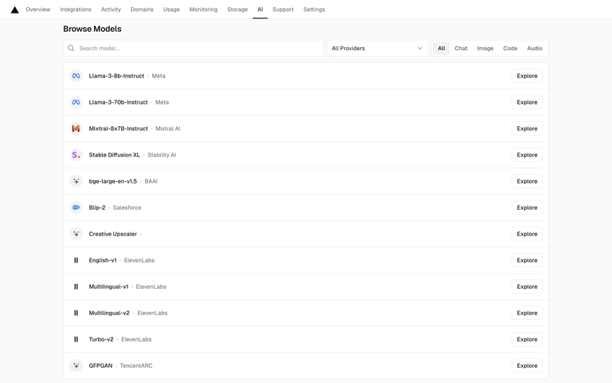
*Vercel — หน้า Browse Models: ช่องค้นหา, dropdown "All Providers", แท็บ All/Chat/Image/Code/Audio, แถวโมเดลพร้อมโลโก้ provider และปุ่ม Explore [Lazyweb]*

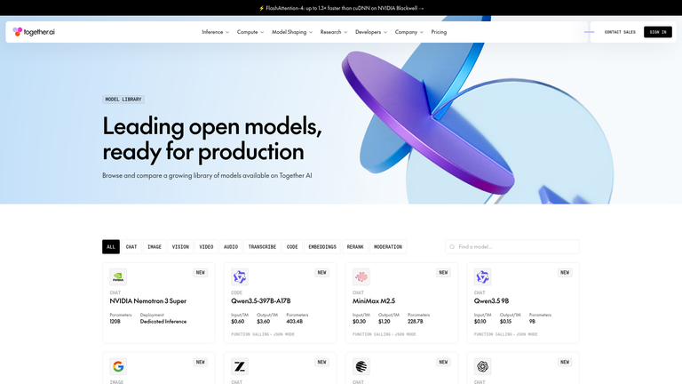
*Together AI — Model Library: hero สั้น ๆ แล้วตามด้วยแท็บประเภทโมเดลและการ์ดโมเดลที่มี Input/Output ราคาต่อ 1M token และ parameters [Lazyweb]. ใน Lazyweb ภาพนี้ถูก index เป็น "Hugging Face Models library" แต่หน้าจอที่เห็นคือ Together AI*

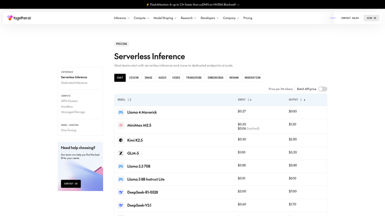
*Together AI — ตารางโมเดล serverless พร้อมสถานะและราคา input token [Lazyweb]*

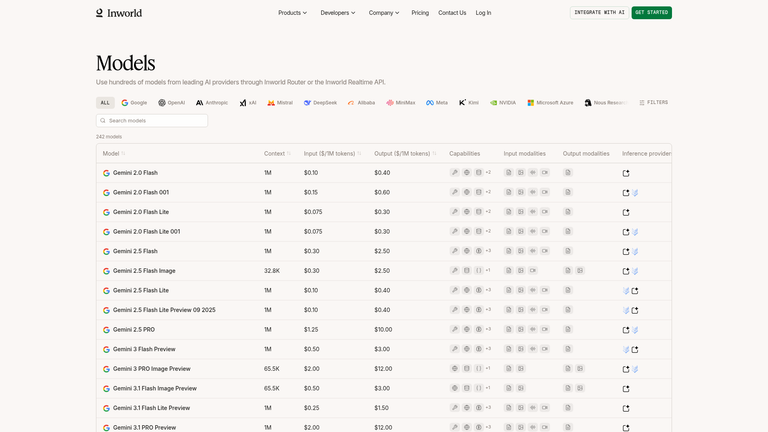
*Inworld — catalog โมเดลสำหรับนักพัฒนา เป็นตารางที่เรียงลำดับได้ [Lazyweb]*

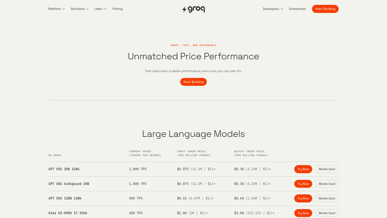
*Groq — LLM ที่จัดอันดับตาม price-performance ในตารางที่ค้นหาได้ [Lazyweb] (match อ่อน 1/3 ใช้เป็นตัวอย่างของ ranking เท่านั้น)*

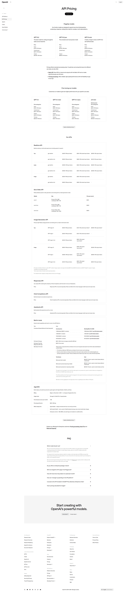
*หน้า API pricing ของ OpenAI: อัตราราคาแบบ token แยกตามหมวดโมเดล [Lazyweb]*

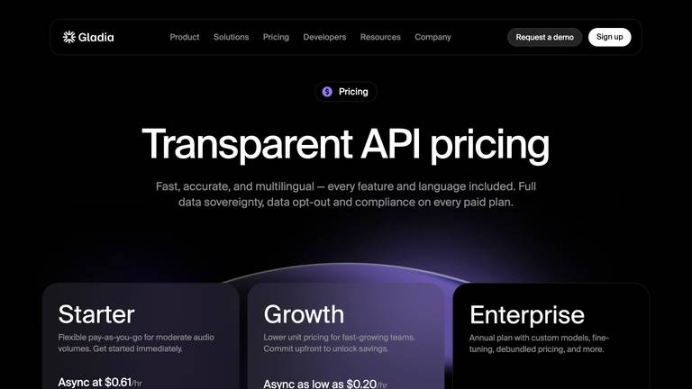
*Gladia — หน้า pricing ของ API service ธีมดำ [Lazyweb]*

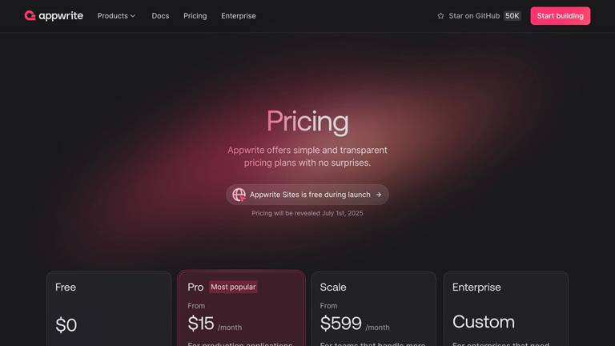
*Appwrite — pricing บนพื้นหลังดำมี gradient: ตัวอย่างที่ตรงกับ Gradient Background Animation และ Dark Mode ใน FR-AIHUB-011/012 [Lazyweb]*

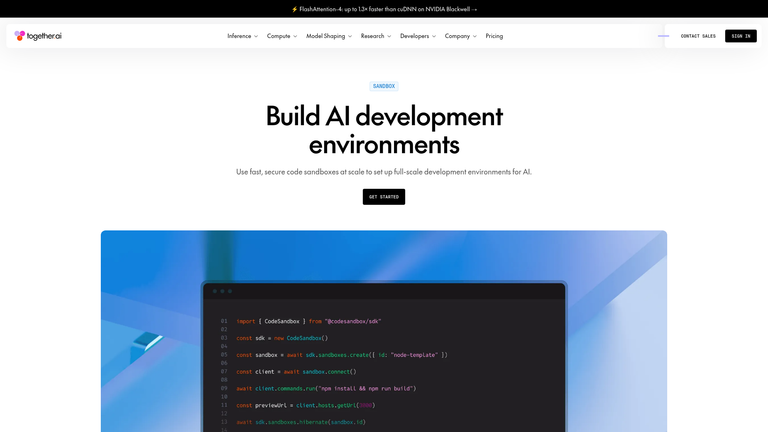
*Together AI — hero: label, headline ใหญ่, subline บรรทัดเดียว, ปุ่ม Get Started หนึ่งปุ่ม, ตามด้วยภาพ code snippet [Lazyweb]*

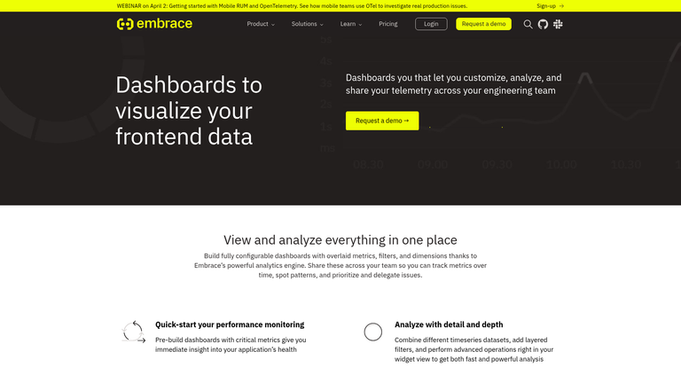
*Embrace — landing page ที่ใช้ภาพ dashboard เป็น visual หลัก [Lazyweb]*

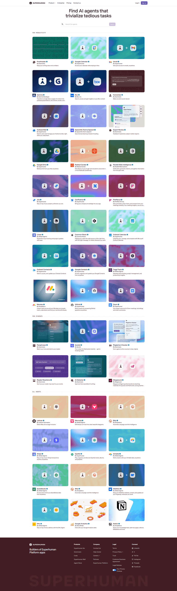
*Superhuman — หน้า discovery ของ AI agents มีช่องค้นหาและ grid การ์ด [Lazyweb]*

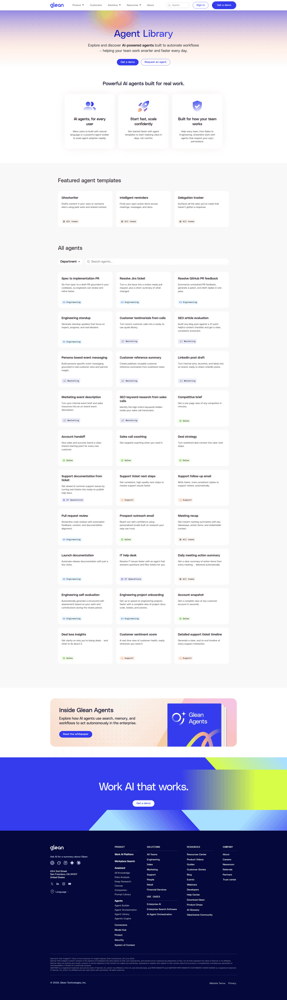
*Glean — agent library สำหรับค้นหา agent template ที่สร้างไว้แล้ว มีหมวดตามแผนก [Lazyweb]*

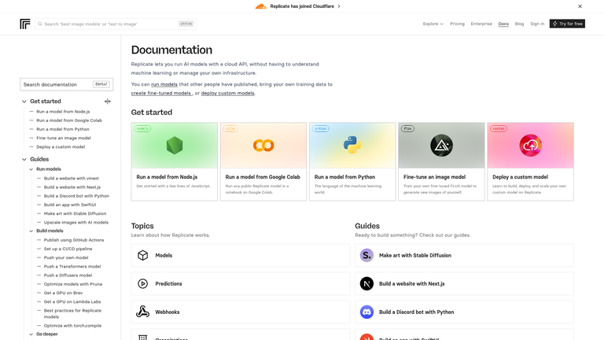
*หน้า docs landing: ช่องค้นหากลางหน้าและการ์ด quick-start [Lazyweb] (ถูก index ภายใต้ company "replicate" แต่คำอธิบายระบุ Hugging Face)*

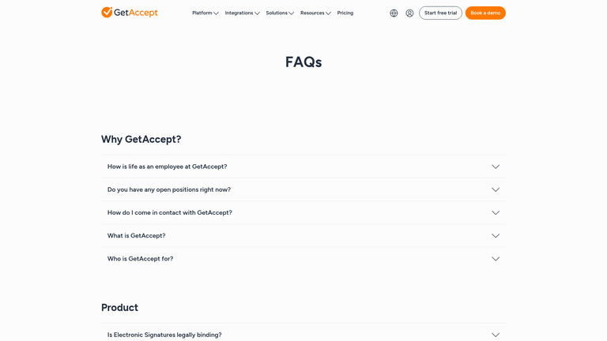
*GetAccept — FAQ แบบ accordion พับ/ขยายได้ [Lazyweb]*

## Patterns

- **Model list คือ "สินค้า"**: ทุก reference ของ AI platform วางรายการโมเดลที่ค้นหา/กรองได้ไว้ใกล้ผู้ใช้ ไม่ซ่อนหลัง login ซึ่งตรงกับเป้าหมาย "ดูราคาและเปรียบเทียบโมเดลได้ทันที" ของ PRD
- **ราคาแสดงเป็นหน่วย token** (`$/1M input`, `$/1M output`) แทนแพ็กเกจรายเดือน เหมาะกับผู้ใช้หลักที่เป็น Developer และสอดคล้องกับรูปแบบ pay-as-you-go
- **Hero แบบประหยัด**: label เล็ก, headline ใหญ่, subline หนึ่งบรรทัด, CTA หลักหนึ่งปุ่ม แล้วตามด้วย visual หรือ code
- **Filter แบบแท็บตามประเภท** (Chat, Image, Code, Audio, …) ช่วยลดความรกเมื่อโมเดลมีหลายสิบรายการ
- **การ์ด/แถวมี action ชัดเจน** (Explore, Try) ต่อโมเดล ทำให้ CTA ไม่จบอยู่ที่ท้ายหน้า

## Anti-Patterns

- **ซ่อนราคาหลัง "Contact sales"**: ตรงข้ามกับเป้าหมาย P-002 ของ PRD
- **Number Counter ที่ไม่มีบริบท**: OQ-016 ยังไม่บอกว่าแสดงตัวเลขอะไร ถ้าไม่มีตัวเลขจริง (เช่น จำนวนโมเดล, จำนวน provider) ให้ข้ามไป อย่าใส่ตัวเลขสมมติ
- **Animation ที่บังคับเสมอ**: ต้องมี fallback เมื่อผู้ใช้ตั้ง `prefers-reduced-motion` ซึ่งสอดคล้องกับ FR-AIHUB-014
- **ตาราง Pricing ที่เปลี่ยนโครงสร้างเมื่อ API ล่ม**: ให้ Default Pricing ใช้ layout เดียวกัน

## Unique Angles

- **Together AI: ราคาและ capability อยู่บนการ์ดโมเดลเลย** ไม่ต้องกดเข้าไปดู ซึ่งตอบ "เปรียบเทียบยาก" (P-006) ได้ตรงกว่าตารางเรียบ ๆ
- **Vercel: แท็บ + provider dropdown + search ในแถบเดียว** กรองได้สามทางโดยไม่ต้องเปลี่ยนหน้า
- **Appwrite: gradient บนพื้นดำใน pricing** ทำให้หน้าที่มีตารางตัวเลขดูไม่แห้ง และใช้ motion เดียวกับ Gradient Background Animation ได้

## Findings

**ที่มาของข้อมูล**
- Lazyweb (desktop): ประมาณ 20 queries รวมค้นด้วย company filter ผ่าน agentic search เดียวกัน แล้วเลือก 14 ภาพที่ `visionDescription` ตรงกับประเด็น
- Web (WebSearch): ผลเกี่ยวกับ OpenRouter, developer-tool landing pages และ dark mode accessibility ดู Sources

**จากเว็บ**
- OpenRouter ใช้ unified API ที่ไม่ต้องสมัครสมาชิก เป็นแนวทางแบบ product-led growth และมี Rankings ที่จัดโมเดลตามการใช้ token พร้อมเปรียบเทียบราคา, latency, throughput ซึ่งสนับสนุนข้อ 1 ด้านบน (ผลค้นไม่มีบทวิเคราะห์ UI โดยตรง ใช้ข้อมูลระดับสรุปเท่านั้น)
- งานศึกษา 100 devtool landing pages ของ Evil Martians (ปี 2025) พบว่า hero มีรูปแบบคล้ายกันมาก และมักตามด้วยโลโก้ลูกค้าหรือตัวเลขการใช้งาน
- Dark mode: ต้องผ่าน contrast AA (4.5:1 ข้อความปกติ, 3:1 ข้อความใหญ่) และตรวจแยกจาก light mode ไม่ใช่แค่กลับสี รวมถึงควรเคารพ `prefers-reduced-motion` PRD ระบุเพียง "AA" โดยไม่ระบุมาตรฐาน (OQ-020) ควรระบุเป็น WCAG 2.2 AA

**ช่องว่างของหลักฐาน (พูดตรง ๆ)**
- ไม่มี OpenRouter ใน Lazyweb จึงไม่มีภาพ UI ของคู่แข่งหลักโดยตรง
- Number Counter: การค้นได้แต่หน้า dashboard analytics (similarity ประมาณ 0.4) ไม่ใช่ stats section บน landing page จึงไม่นำมาใช้เป็นหลักฐาน
- Footer: ผลค้นเป็นหน้า contact/404 ไม่ตรงประเด็น จึงไม่มีข้อเสนอเรื่อง Footer
- ไม่ได้จับภาพหน้าเว็บสดของคู่แข่ง (ไม่มีเครื่องมือ browse สำหรับบันทึกไฟล์ภาพในรอบนี้) ภาพทั้งหมดมาจาก Lazyweb
- ภาพ 11 จาก 14 ภาพตรวจกับ `visionDescription` เท่านั้น ไม่ได้เปิดดูด้วยตา ยกเว้น Vercel, Together AI models library และ Together AI hero

**ประเด็น PRD ที่กระทบการออกแบบ**
- OQ-001 Hero ใช้ Video หรือ Illustration: reference ที่เจอใช้ภาพ + code snippet ไม่ใช่ video
- OQ-013 "เปรียบเทียบโมเดล": ถ้าต้องการเปรียบเทียบแบบเคียงข้างกัน ต้องเพิ่มใน scope เพราะ PRD ตอนนี้มีเพียงรายการเรียงตาม Popularity
- OQ-026 Dark Mode: ถ้าไม่มี toggle ให้ตรวจ contrast ชุดเดียวคือ dark

## Sources

- Lazyweb agentic search `1f104a5b-96ad-4e63-ad0f-76e9a78b4e09` (ภาพทั้งหมดใน `references/`, label `[Lazyweb]`)
- [OpenRouter February Release Spotlight](https://openrouter.ai/blog/announcements/february-release-spotlight/)
- [OpenRouter Analysis (Extruct)](https://www.extruct.ai/hub/openrouter-ai/)
- [We studied 100 dev tool landing pages (Evil Martians)](https://evilmartians.com/chronicles/we-studied-100-devtool-landing-pages-here-is-what-actually-works-in-2025)
- [Landing Page UX Design Best Practices & Guide 2026](https://www.designstudiouiux.com/blog/landing-page-ux-best-practices/)
- [The Designer's Guide to Dark Mode Accessibility](https://www.accessibilitychecker.org/blog/dark-mode-accessibility/)
- [Dark mode done right (DEV Community)](https://dev.to/javascriptwizzard/dark-mode-done-right-performance-accessibility-considerations-43b1)
